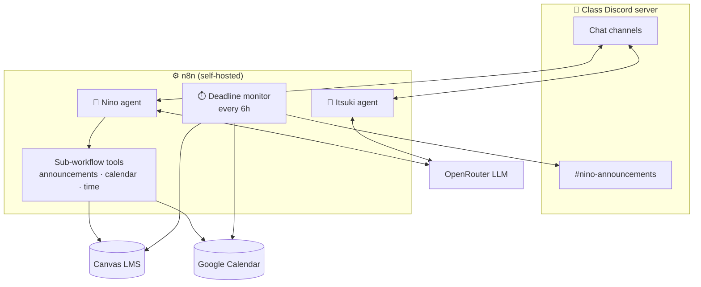

# Nakano Bots 🤖📚

**Nakano Bots** is a pair of AI Discord bots built with **[n8n](https://n8n.io)** to help a university Computer Science class keep up with school. Each bot has one job:

| Bot | Role | What it does |
|---|---|---|
| 📅 **[Nino](nino-bot/)** | Deadline monitor | Watches **Canvas LMS** and a shared **Google Calendar**, posts reminders before assignments and events are due, and adds or removes calendar events on request. |
| 🍙 **[Itsuki](itsuki-bot/)** | Study buddy | Answers general-knowledge and study questions in Discord. It explains concepts instead of doing graded work. |

Both bots live in the class Discord server, run on a self-hosted n8n instance, and each has its own persona.

---

## 🏗️ How it fits together



- **Nino** has two paths. A scheduled workflow with no LLM pushes deadline digests every 6 hours, and an AI agent answers questions by calling small sub-workflows as tools. [Read more →](nino-bot/README.md)
- **Itsuki** is a single n8n AI Agent with conversation memory and no external tools, which keeps it cheap and simple. [Read more →](itsuki-bot/README.md)

---

## 🛡️ Shared principles

- **One job per bot.** Splitting monitoring and Q&A gives each agent a short, focused prompt. When someone asks Nino a question that isn't about deadlines, Nino sends them to Itsuki.
- **Grounded where it matters.** Nino only reports deadlines that come back from Canvas or the Calendar and never invents them. Its scheduled reminders don't involve the LLM at all.
- **Safe for a whole class.** Only class-wide information is shared. Personal data such as grades, submissions and private comments is never surfaced.
- **Resistant to prompt injection.** Neither bot will reveal its prompt, tools or keys. Canvas content and user messages are treated as data, not instructions.
- **Academic integrity.** Both bots decline to take exams or write graded work, and offer to explain the concept instead.
- **Discord-native output.** Replies use Discord markdown, stay under the message length limit, and show dates in `Asia/Manila` time.

---

## 🧰 Tech stack

| Layer | Tools |
|---|---|
| Automation & agents | n8n (AI Agent, Code nodes with Luxon, sub-workflows, built-in memory) |
| LLM | OpenRouter |
| Data sources | Canvas LMS REST API, Google Calendar API |
| Chat | Discord bot integration |
| Hosting | Local, self-hosted n8n |

---

## 📁 Repository structure

```
nakano-discord-bots/
├── nino-bot/
│   ├── README.md
│   ├── agent/
│   │   └── nino-agent.json
│   └── workflows/
│       ├── nino-deadline-monitoring.json
│       ├── nino-fetch-announcements.json
│       ├── nino-fetch-calendar-events.json
│       └── nino-fetch-time.json
└── itsuki-bot/
    ├── README.md
    └── Itsuki-agent.json
```

---

## 🚀 Running it

Both bots are exported n8n workflows and agents. Import the JSON files into your own n8n instance and connect your own credentials: a Canvas access token, Google Calendar OAuth2, OpenRouter and Discord bot tokens. No credentials are included in this repo.

---

## 🗺️ Roadmap

- [ ] Nino: summarize Canvas course announcements
- [ ] Nino: optionally pull announcements from MS Teams
- [ ] Itsuki: web search for up-to-date answers
- [ ] Always-on hosting for both bots

---

<sub>Nino handles deadlines and Itsuki handles questions.</sub>
