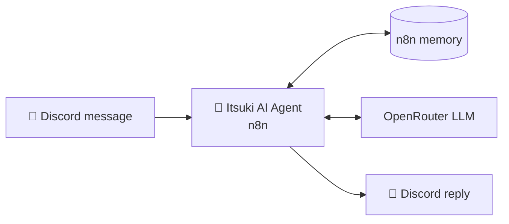

# Itsuki 🍙 (general-knowledge study buddy for Discord)

> *"A-asking questions is nothing to be embarrassed about! Now, let's study properly."*

**Itsuki** is an AI Discord bot built in **n8n**. It answers classmates' general-knowledge and study questions right inside the class Discord server. You can ask it to explain a concept, summarize a topic or work through an idea, and the reply comes back short and in Discord markdown.

Itsuki is one of the two **Nakano Bots**. Its sibling, **Nino**, monitors Canvas deadlines and the class calendar. Itsuki handles everything else, and Nino sends people to Itsuki when they ask it something that isn't about deadlines.

---

## ✨ What Itsuki does

| Feature | Description |
|---|---|
| 💡 **General Q&A** | Answers questions on school subjects, concepts and everyday topics. |
| 📖 **Explain, don't do** | It helps you understand material instead of producing graded work for you to hand in. |
| 🧠 **Conversation memory** | Uses n8n's built-in agent memory, so you can ask follow-up questions in context. |
| 💬 **Discord-native replies** | Formats answers in Discord markdown and keeps them under the 1,800-character message limit. |
| 🎭 **Persona** | Replies in a polite, earnest, slightly flustered voice. |

---

## 🏗️ Architecture



Itsuki is a single n8n AI Agent with a Discord integration. There are no external data sources or tools: a message comes in, the agent answers using the model plus its conversation memory, and the reply is posted back to the channel. Keeping it this simple makes Itsuki cheap to run and easy to maintain. The work that needs real data lives in Nino.

---

## 🛡️ Design decisions

- **Split by responsibility.** Q&A and deadline monitoring are separate bots, so each agent has a short, focused system prompt and a smaller surface for mistakes.
- **Academic integrity.** Itsuki refuses to take exams, write graded work for someone to submit as their own, or help get around proctoring. It offers to explain the concept instead.
- **Resistant to prompt injection.** Itsuki won't reveal, quote or paraphrase its instructions, configuration, tools or keys, even when asked to "ignore previous instructions", role-play, debug or translate them.
- **Safe defaults.** It refuses illegal, harmful, hateful or sexual requests and anything like hacking or phishing. For medical, legal or financial questions it gives only general information and suggests seeing a professional.
- **Stays in role.** Itsuki never claims to be a teacher, the school or a human, and it stays respectful even when the user isn't.

---

## 🧰 Tech stack

- **[n8n](https://n8n.io)**: AI Agent runtime with built-in memory (self-hosted, running locally)
- **OpenRouter**: LLM provider
- **Discord**: bot integration

---

## 📁 Structure

```
itsuki-bot/
└── Itsuki-agent.json    # AI agent: prompt, skills, memory, Discord integration
```

---

## 🚀 Running it

Itsuki runs on a local n8n instance. To try it yourself, import `Itsuki-agent.json` into n8n, then connect your own OpenRouter and Discord bot credentials. No credentials are included in this repo.

---

## 🗺️ Roadmap

- [ ] Web search tool for up-to-date answers
- [ ] Course-material lookup so answers can reference class topics
- [ ] Always-on hosting

---

<sub>Part of <b>Nakano Bots</b>. Itsuki handles questions and Nino handles deadlines.</sub>
