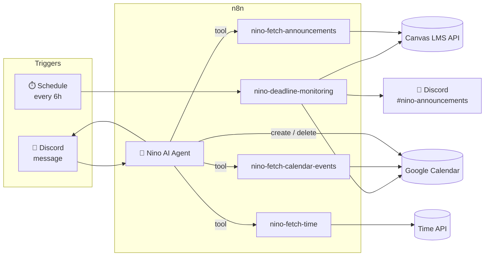

# Nino 📚 (Canvas deadline monitor for Discord)

> *"Hmph. You still haven't checked your deadlines? Fine, I'll do it for you."*

**Nino** is an AI Discord bot built entirely in **n8n**. It keeps a university class on top of their coursework: it watches Canvas LMS for upcoming assignments and events, combines them with a shared Google Calendar, and posts reminders to the class Discord server before anything is due. Classmates can also message Nino directly to ask what's coming up or to add things to the calendar.

Nino is one of the two **Nakano Bots**. Its sibling, **Itsuki**, handles general-knowledge Q&A. Nino only deals with deadlines and schedules.

---

## ✨ What Nino does

| Feature | Description |
|---|---|
| ⏰ **Automatic deadline alerts** | Every 6 hours, Nino checks Canvas and Google Calendar and posts anything due in the next **4 days** to `#nino-announcements`. |
| 💬 **Conversational lookups** | You can ask things like *"what's due this week?"* or *"any events on Friday?"* and get the answer grouped by course with the soonest item first. Anything due within 24 hours gets a ⚠️ flag. |
| 🗓️ **Calendar scheduling** | You can ask Nino to add, list or delete events on the class Google Calendar in plain language. It handles both timed and all-day events. |
| 🕐 **Timezone-correct** | It reads the current Philippine time from a live time API and converts every date to `Asia/Manila`, so you get output like `Fri, Oct 31 - 11:59 PM`. |
| 🧹 **Clean Discord output** | Canvas HTML is stripped to plain text, long descriptions are cut down, and replies stay under Discord's message limit. |
| 🎭 **Persona** | Nino replies in a short, slightly tsundere voice. |

---

## 🏗️ Architecture



Nino has two paths:

1. **Push (scheduled monitor).** This is a deterministic workflow with no LLM in it. It pulls Canvas `upcoming_events` and Google Calendar events, drops past items and recurring events, keeps only those inside a 4-day window, and posts a formatted digest. When nothing is due, it posts an "all caught up 🎉" message.
2. **Pull (AI agent).** This is an n8n AI Agent connected to Discord. It answers questions by calling small, focused sub-workflows as tools, so the model only sees cleaned and structured data.

---

## 🧩 Workflows

| Workflow | Role |
|---|---|
| [`nino-deadline-monitoring`](workflows/nino-deadline-monitoring.json) | Scheduled pipeline: Canvas + Calendar → filter → merge → format → Discord |
| [`nino-fetch-announcements`](workflows/nino-fetch-announcements.json) | Agent tool: fetches Canvas `/users/self/upcoming_events` and turns each item into a compact task (course, title, type, due date, lock date) |
| [`nino-fetch-calendar-events`](workflows/nino-fetch-calendar-events.json) | Agent tool: gets the next month of Google Calendar events, without recurring ones |
| [`nino-fetch-time`](workflows/nino-fetch-time.json) | Agent tool: returns the current Asia/Manila time, which the agent treats as the true current time |
| [`agent/nino-agent.json`](agent/nino-agent.json) | Agent definition: system prompt, tools, skills, memory and Discord integration |

### Agent tools

- **Fetch Announcements** reads deadlines from Canvas.
- **Fetch Events** reads the Google Calendar.
- **Add Schedules (timed / all-day)** creates calendar events, with the start and end times extracted by the model in ISO-8601 `+08:00` format.
- **Get Many Events / Delete Event** looks up an event ID and then removes that event.
- **Retrieve Ids** resolves Discord members so Nino can mention them properly instead of typing a plain `@name`.
- **Nino Fetch Time** returns the real current time.

---

## 🛡️ Design decisions

- **The LLM is kept out of the critical path.** Scheduled reminders never go through the model, so they can't hallucinate and they cost no tokens. The agent is only used when someone asks it something.
- **Grounded answers only.** The system prompt limits Nino to the Canvas and Calendar data its tools return: *"Never invent deadlines, courses, or details."*
- **Built for a whole class.** Nino serves a shared Discord server, so it only exposes class-wide information like titles, due dates and descriptions. Personal data such as grades, submissions and private comments is never surfaced.
- **Resistant to prompt injection.** Canvas announcements and user messages are treated as content, not instructions. Nino refuses to reveal its prompt, tools, tokens or workflow internals.
- **Academic integrity.** Nino declines requests to do graded work or get around exams, and offers to explain the concept instead.
- **Small, single-purpose sub-workflows.** Each tool does one job, which makes each one easy to test alone and reuse across the scheduled path and the agent path.

---

## 🧰 Tech stack

- **[n8n](https://n8n.io)**: workflow automation and AI Agent runtime (self-hosted, running locally)
- **Canvas LMS REST API**: `/users/self/upcoming_events`
- **Google Calendar API**: OAuth2
- **Discord**: bot integration for messages, mentions and the announcement channel
- **OpenRouter**: LLM provider for the agent
- **Luxon** (built into n8n Code nodes): timezone-aware date handling

---

## 📁 Structure

```
nino-bot/
├── agent/
│   └── nino-agent.json              # AI agent: prompt, tools, skills, memory
└── workflows/
    ├── nino-deadline-monitoring.json
    ├── nino-fetch-announcements.json
    ├── nino-fetch-calendar-events.json
    └── nino-fetch-time.json
```

---

## 🚀 Running it

Nino runs on a local n8n instance. To try it yourself, import the JSON files into n8n. Then create your own credentials (a Canvas access token as Header Auth, Google Calendar OAuth2, and a Discord bot) and point the Discord and Calendar nodes at your own server and calendar. No credentials are included in this repo.

---

## 🗺️ Roadmap

- [ ] Summarize Canvas course announcements (`/announcements`) in 1–3 bullet points
- [ ] Optionally pull announcements from MS Teams
- [ ] Always-on hosting

---

<sub>Part of <b>Nakano Bots</b>. Nino handles deadlines and Itsuki handles questions.</sub>
